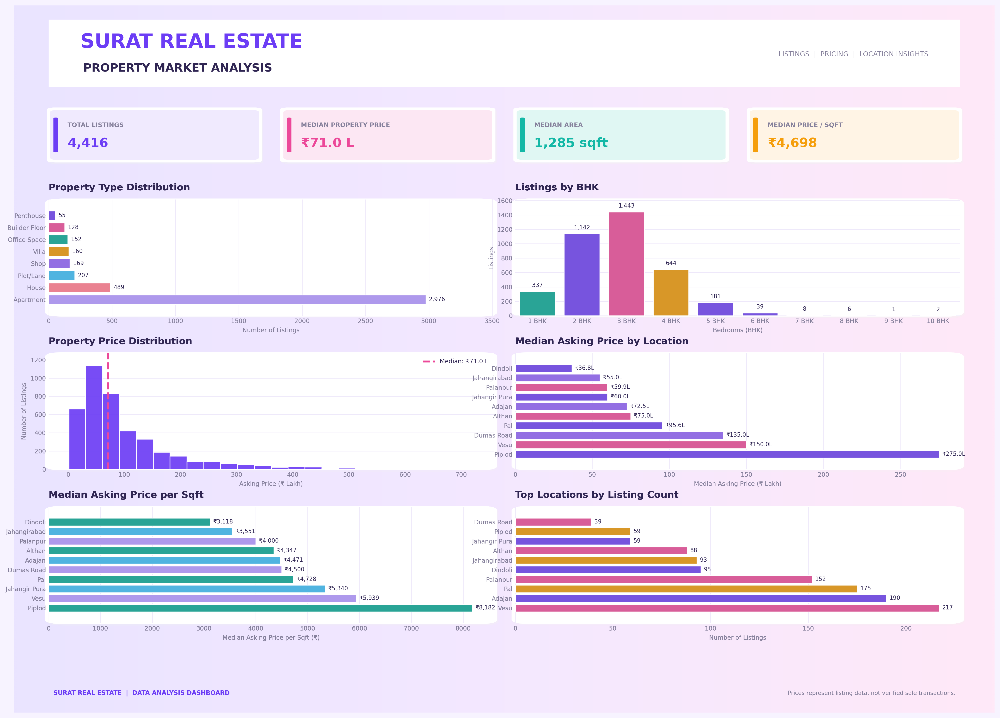

# Surat Real Estate Market Analysis

An end-to-end real estate data analysis project using Python to explore property listings, pricing patterns, property types, and location-wise market trends in Surat, Gujarat.

The project focuses on data cleaning, data quality checks, exploratory data analysis (EDA), and data visualization using Pandas, NumPy, Matplotlib, and Seaborn.

## Project Overview

The objective of this project is to analyze real estate listings in Surat and understand property prices, property sizes, BHK distribution, and location-wise differences in asking prices.

The project covers the complete analytical workflow, from raw data inspection and cleaning to exploratory analysis and dashboard presentation.

## Project Objectives

- Clean and standardize real estate listing data.
- Identify missing values, duplicate records, and inconsistent entries.
- Convert property prices and area measurements into consistent numeric formats.
- Analyze property types, BHK configurations, and location-wise listings.
- Explore property price distributions and price per square foot.
- Identify potential outliers and data quality issues.
- Create visualizations and a dashboard to communicate market insights.

## Tools and Technologies

- **Python** — Data analysis and processing
- **Pandas** — Data cleaning and manipulation
- **NumPy** — Numerical operations
- **Matplotlib** — Data visualization
- **Seaborn** — Statistical visualization, where used in the analysis
- **Jupyter Notebook** — Interactive analysis and documentation

## Data Cleaning and Preparation

The data preparation workflow covers:

1. Inspecting the dataset structure, columns, and data types.
2. Checking missing values and blank entries.
3. Identifying and handling duplicate records.
4. Standardizing text fields and categorical values.
5. Converting property prices into numeric values.
6. Standardizing area measurements for comparison.
7. Extracting relevant property attributes such as BHK, property type, and location.
8. Validating price and area values.
9. Examining potential outliers in numerical columns.
10. Preparing data for exploratory analysis and visualization.

The exact cleaning and transformation steps are documented in the Jupyter Notebook.

## Exploratory Data Analysis

The analysis explores the following areas:

- Property type distribution
- Listings by BHK configuration
- Property asking-price distribution
- Median asking price by location
- Median asking price per square foot
- Top locations by listing count
- Differences in property prices across locations

## Dashboard Preview



The dashboard presents key property-market metrics and visualizations in a single view, including total listings, median property price, median area, median price per square foot, property type distribution, BHK distribution, and location-wise pricing patterns.

## Key Insights

The dashboard highlights the following figures:

- **Total Listings:** 4,416
- **Median Property Price:** ₹71.0 lakh
- **Median Area:** 1,285 sq ft
- **Median Price per Sq Ft:** ₹4,698
- **Most Listed Property Type:** Apartments, with 2,976 listings
- **Most Common BHK Category:** 3 BHK, with 1,443 listings
- **Highest Displayed Median Asking Price by Location:** Piplod, at ₹275 lakh
- **Highest Displayed Median Price per Sq Ft:** Piplod, at ₹8,182

These figures are based on the dashboard and describe asking prices in the available listings, not verified completed property transactions.

## Repository Contents

- `Matplotlib_project.ipynb` — Python notebook containing the data analysis workflow
- `surat_real_estate_dashboard.png` — Dashboard preview image
- `surat_real_estate_dashboard.pdf` — PDF version of the dashboard
- `README.md` — Project documentation

## How to Run the Project

1. Install Python on your computer.
2. Install Jupyter Notebook.
3. Install the required Python libraries:

   ```bash
   pip install pandas numpy matplotlib seaborn jupyter
   ```

4. Open `Matplotlib_project.ipynb` in Jupyter Notebook.
5. Update the input CSV file path in the notebook to match your local environment.
6. Run the notebook cells in sequence to reproduce the analysis.

**Dataset availability:** The original source CSV is not included in this public repository because permission to share the source data must be confirmed separately. Running the notebook from the beginning requires an authorized, compatible copy of the dataset.

## Limitations

- Asking prices may differ from actual property transaction prices.
- Missing or inconsistent source values may affect the analysis.
- Potential outliers require contextual review before being classified as errors.
- Findings reflect the available listings and may not represent the entire Surat property market.

## Disclaimer

This project is intended for educational and data analytics portfolio purposes. The analysis is based on property listing information and should not be interpreted as professional property valuation or verified real estate transaction data.
